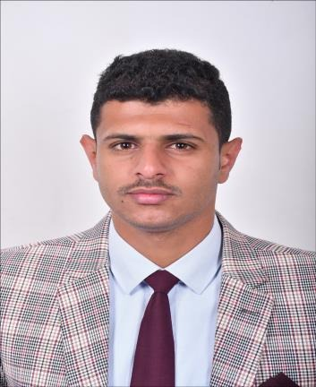

<!DOCTYPE html>
<html lang="ar" dir="rtl">
<head>
<meta charset="utf-8">
<meta name="viewport" content="width=device-width, initial-scale=1">
<title>الحسن محمد حسن السمان — السيرة الذاتية</title>
<meta name="description" content="أمين عام مركز التطوير وضمان الجودة · مدرس بكلية الإدارة الطبية — جامعة 21 سبتمبر للعلوم الطبية والتطبيقية — صنعاء، اليمن">

</head>
<body>

<header>
  
  

    <h1>الحسن محمد حسن السمان</h1>
    
Al-hasan Al-saman

    
أمين عام مركز التطوير وضمان الجودة · مدرس بكلية الإدارة الطبية

    
جامعة 21 سبتمبر للعلوم الطبية والتطبيقية — صنعاء، اليمن

    
البريد الجامعي: <a href="mailto:alhsn6857@21umas.edu.ye" rel="noopener">alhsn6857@21umas.edu.ye</a>ORCID: <a href="https://orcid.org/0009-0000-5983-2408" rel="noopener">0009-0000-5983-2408</a>Google Scholar: <a href="https://scholar.google.com/citations?user=JGKMXZEAAAAJ&hl=ar" rel="noopener">الملف البحثي</a>صفحة الجامعة: <a href="https://21umas.edu.ye/cv/266" rel="noopener">21umas.edu.ye/cv/266</a>الموقع الشخصي: <a href="https://alhsn6857.github.io" rel="noopener">alhsn6857.github.io</a>

  

</header>

<a class="btn" href="CV-Al-hasan-Al-saman.pdf">تحميل السيرة (PDF)</a><a class="btn" href="CV-Al-hasan-Al-saman.docx">نسخة Word</a>

<section><h2>الملخص المهني</h2>
إداري وباحث أكاديمي متخصص في تطوير الأنظمة المؤسسية ورفع جودة الأداء مع تركيز واضح على سلامة المرضى. أمتلك خبرة في قيادة فرق متعددة التخصصات، ووضع وتنفيذ خطط استراتيجية، وصياغة سياسات وإجراءات تُحسّن الامتثال وتحقق نتائج تشغيلية قابلة للقياس. متمكن من إعداد تقارير الأداء بصورة احترافية وإدارة العمليات الإدارية والمالية، وأسعى لتمكين الفرق وتحويل التحديات إلى تحسينات مؤسسية كإنجازات حقيقية وثابتة.
</section>
<section><h2>التعليم</h2><article class="entry"><h3>ماجستير في الإدارة الصحية</h3>
جامعة 21 سبتمبر للعلوم الطبية والتطبيقية — كلية الإدارة الطبية · 2022 – 2026م

ماجستير بتقدير امتياز. تركزت الدراسة حول أثر رقابة المجلس الطبي اليمني في تطبيق المعايير الإلزامية لسلامة المرضى في المستشفيات، بهدف تحسين كفاءة وجودة الرعاية الصحية.
<ul><li>السنة التمهيدية: أُنجزت عام 2024م. مناقشة الرسالة: 23 سبتمبر 2026م.</li><li>عنوان الرسالة: «أثر رقابة المجلس الطبي اليمني في تطبيق المعايير الإلزامية لسلامة المرضى في المستشفيات اليمنية».</li><li>لجنة المناقشة: د. محمد دائل الهاشمي (مشرفًا)، أ.م.د. منير الوصابي (مناقشًا داخليًا)، أ.د. عبدالخالق طواف (مناقشًا خارجيًا).</li></ul></article><article class="entry"><h3>بكالوريوس في الإدارة الطبية</h3>
جامعة 21 سبتمبر للعلوم الطبية والتطبيقية — كلية الإدارة الطبية · 2016 – 2020م

حصلت على درجة البكالوريوس بتقدير جيد جدًا. خلال دراستي بنيتُ علاقات إيجابية مع أساتذتي، مما ساهم لاحقًا في حصولي على فرصة التعيين كمعيد في الكلية.
</article><article class="entry"><h3>بكالوريوس في الشريعة والقانون</h3>
جامعة صنعاء — كلية الشريعة والقانون · 2018 – 2022م

بكالوريوس بتقدير جيد جدًا في الشريعة والقانون. اكتسبتُ خلالها معرفة متعمقة وواسعة بالأُطر التشريعية والقانونية، ما عزّز من قدرتي على تفسير الأنظمة واللوائح ذات الصلة، وتقديم توصيات إدارية متوافقة مع القوانين.
</article></section>
<section><h2>الخبرات المهنية والمناصب الإدارية</h2><article class="entry"><h3>أمين عام مركز التطوير وضمان الجودة</h3>
جامعة 21 سبتمبر للعلوم الطبية والتطبيقية · 2024م – الآن
<ul><li>إعداد تقارير دورية عن أداء الجامعة، وإعداد الخطط والمقترحات لتحسين أدائها وتصنيفها المحلي والإقليمي والعالمي.</li><li>التنسيق والإشراف على الورش التي تنفذها الجامعة بالتعاون مع المركز، والمشاركة في تنظيم مؤتمراتها.</li><li>مقرر فريق إعداد الخطة الاستراتيجية للمركز 2026–2030م.</li><li>الإشراف على رؤساء الوحدات التابعة للمركز وتوجيههم لضمان تناسق الأدوار وتكاملها.</li></ul></article><article class="entry"><h3>مدرس (عضو هيئة تدريس مساعد) — كلية الإدارة الطبية</h3>
جامعة 21 سبتمبر للعلوم الطبية والتطبيقية · 2021م – الآن
<ul><li>تدريس التطبيقات العملية لمواد: محاسبة المستشفيات، بحوث العمليات، الاقتصاد الجزئي، الاقتصاد الكلي، وإدارة الإنتاج والعمليات.</li></ul></article><article class="entry"><h3>أمين عام كلية الهندسة والحاسوب</h3>
جامعة 21 سبتمبر للعلوم الطبية والتطبيقية · 2024 – 2026م
<ul><li>الإشراف على الشؤون المالية والإدارية للكلية ومتابعتها، وإدارة الموارد والاحتياجات التشغيلية وضمان سلاسل التوريد الداخلية.</li></ul></article><article class="entry"><h3>رئيس وحدة التدريب والتأهيل، ثم رئيس وحدة القياس والتقويم</h3>
مركز التطوير وضمان الجودة — جامعة 21 سبتمبر · التدريب والتأهيل 2023–2024م · القياس والتقويم 2022–2023م
<ul><li>بناء نماذج تقييم البرامج الأكاديمية والمقررات وأعضاء هيئة التدريس والخدمات المكتبية عبر نماذج قوقل، وتنفيذ التقييم الدوري الفصلي وإعداد التقارير النهائية.</li><li>بناء دليل التقويم والقياس بالجامعة، والمشاركة في إعداد دليل التطوير وضمان الجودة.</li></ul></article><article class="entry"><h3>مختص التعليم الإلكتروني والتدريب الميداني</h3>
كلية الإدارة الطبية — جامعة 21 سبتمبر · 2020 – 2022م
</article></section>
<section><h2>الإنجازات والمشاريع الاستراتيجية</h2><ul><li>التخطيط الاستراتيجي: المشاركة في تحديث التوجهات الاستراتيجية للجامعة (2026–2030م)، وإعداد الخطة الاستراتيجية، وبناء نماذج تحليل البيئة الداخلية والخارجية، وتنفيذ ورشة إقرارها بمشاركة قيادات الدولة (يناير 2026م).</li><li>تطوير البرامج الأكاديمية: الإعداد والتنسيق لورشة إشهار برامج الدكتوراة الطبية بالجامعة (2025م).</li><li>توسيع الكليات التخصصية: تنسيق ورشة إشهار خمسة برامج ماجستير بكلية طب الأسنان، تزامنًا مع المؤتمر الدولي العاشر للجامعة.</li><li>الدعم المؤسسي: قيادة وحدات التدريب والقياس لضمان مطابقة المخرجات الأكاديمية لمعايير الجودة الشاملة.</li></ul></section>
<section><h2>الإنتاج العلمي</h2>
  <h3>أبحاث ومنشورات</h3>
  
<strong>الرقابة التنظيمية والامتثال للمعايير الإلزامية لسلامة المرضى في اليمن: دراسة مقطعية</strong>
مجلة العلوم الإدارية (Journal of Administrative Sciences)، المجلد 1، العدد 3، 12 سبتمبر 2026م · بحث مستلّ من رسالة الماجستير، بالاشتراك مع منير الوصابي ومحمد دائل
<a href="https://doi.org/10.65693/jas.2026.v1i3.368" rel="noopener">DOI: 10.65693/jas.2026.v1i3.368</a>

<strong>النظام الصحي اليمني: من أزمة الإدارة الطبية إلى خارطة طريق التحول الصحي | The Yemeni Healthcare System: From Medical Administration Crisis to a Roadmap for Health Transformation</strong>
تقرير بحثي منشور على ResearchGate، 2026م
<a href="https://doi.org/10.13140/RG.2.2.28218.35520" rel="noopener">DOI: 10.13140/RG.2.2.28218.35520</a>

  <h3>المشاركات في المؤتمرات العلمية</h3><ul><li>المؤتمر الدولي الثالث للرسول الأعظم (2025م): «المنهج النبوي في معالجة تحديات البحث العلمي: دراسة تحليلية لأثر اللغة، والوعي، ووسائل النشر».</li><li>المؤتمر الدولي الثاني للرسول الأعظم (2024م): «الاسترشاد بالمنهج النبوي لمعالجة وتصحيح الممارسات الإدارية المغلوطة في واقعنا المعاصر».</li><li>المؤتمر الأول للإدارة الطبية: «ماهية الإدارة الطبية».</li></ul>
</section>
<section><h2>التدريب والخبرة الميدانية</h2><ul><li>منسق جودة متدرب — المستشفى اليمني الصيني ومستشفى 48 (2020م): قياس مؤشرات الأداء (KPIs) في قسم صيانة الأجهزة والمعدات الطبية، وإدارة سجلات الرقود والعهد الطبية، ودراسة الدورة المستندية الإدارية والمالية.</li><li>متدرب — مستشفى الثورة العام، صنعاء (2020م): المشاركة مع رئاسة قسم الطوارئ وإدارة الجودة في تنفيذ مشروع تحسين شامل لقسم الطوارئ.</li></ul></section>
<section><h2>الشهادات والدورات</h2><ul><li>شهادة الكفاءة في اللغة الإنجليزية واللغة العربية والحاسوب — جامعة 21 سبتمبر (2026م).</li><li>ورشة تدريب المدربين السريريين وفق معايير وسياسات الجودة الصحية العالمية — جامعة 21 سبتمبر (نوفمبر 2021م).</li><li>دورة التعليم الطبي المبني على مخرجات التعلم، ودورة السكرتارية الإبداعية والأرشفة الإلكترونية وتحسين بيئة العمل وفق منهجية الكايزن — جامعة 21 سبتمبر (1444هـ).</li><li>دورة Advanced في اللغة الإنجليزية — مركز اللغات بجامعة 21 سبتمبر (2023م).</li><li>شهادة منسق جودة — المعهد اليمني للجودة الصحية (2019م).</li><li>دبلوم متقدم في اللغة الإنجليزية للأعمال — معهد اكسل إيتا للتدريب (2018 – 2019م).</li><li>دبلوم الإنجاز الوظيفي: التخطيط الاستراتيجي، مهارات الاتصال، إعداد التقارير، المشاريع الصغيرة والمتوسطة، حل المشكلات وإدارة الأزمات.</li></ul></section>
<section><h2>المهارات</h2>
<strong>الإدارة والتخطيط الاستراتيجي:</strong> صياغة الرؤية والرسالة والأهداف، تحليل البيئة (SWOT)، رسم السياسات وإجراءات التشغيل القياسية، إدارة المخاطر، الموازنات التقديرية ودراسات الجدوى.

<strong>الجودة وسلامة المرضى:</strong> منهجية كايزن، FOCUS-PDCA، تقييم المخاطر، مؤشرات الأداء (KPIs)، إعداد تقارير الأداء.

<strong>القانون والأنظمة:</strong> صياغة العقود، القانون الإداري (القرار والعقد الإداري)، الإلمام بقوانين المرافعات والعمل والتجارة والعقوبات.

<strong>التقنية:</strong> حزمة Microsoft Office، نماذج قوقل، شبكات الوايرلس وأنظمة MikroTik.

<strong>التدريب:</strong> تصميم وتقديم دورات في حل المشكلات (FOCUS-PDCA)، وتحليل الوضع الراهن (SWOT)، وتقييم المخاطر.
<h2>اللغات</h2>
العربية (لغة أم) · الإنجليزية (جيد جدًا)
</section>
<footer>الحسن محمد حسن السمان © 2026</footer>

</body>
</html>
